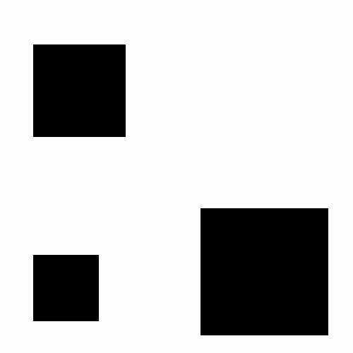
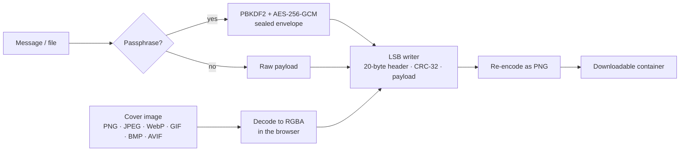
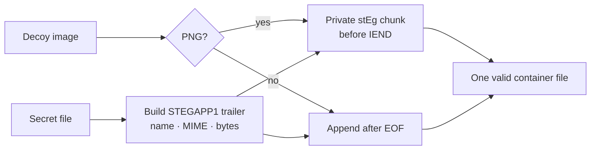

<div align="center">



# masc

**Hide data. In plain sight.**

Client-side steganography that tucks messages and files inside ordinary images.
No uploads. No accounts. No server-side processing.

[](https://kit.svelte.dev/)
[](https://www.rust-lang.org/)
[](#privacy-model)
[](./LICENSE)

[How it works](#how-it-works) · [Quick start](#quick-start) · [Usage](#usage) · [Architecture](#project-layout) · [Security](#security-and-limitations) · [Contributing](#contributing) · [License](#license)

</div>

---

> [!IMPORTANT]
> **masc is source-available, not open source.**
> Copyright © 2026 [CoderSilicon](https://github.com/CoderSilicon). All rights reserved.
> You may **use** masc for **noncommercial purposes**, but you may **not modify,
> redistribute, or claim ownership** of it.
> Read the full [PolyForm Strict License 1.0.0](./LICENSE) before you use the project.

## Why masc

Most tools scramble data into something that looks like a secret. masc does the
opposite: it makes the secret look like nothing at all.

A photo of a dog stays a photo of a dog. A PDF stays a PDF. Under the surface, masc can
carry a message or an entire file inside the exact bytes of the image — with no visible
difference, no network request, and no third party in the loop.

The entire pipeline runs in your browser. Files are decoded, modified, and re-encoded on
your device. Nothing is uploaded.

### What you can do

| | Capability | What it means in practice |
| --- | --- | --- |
| 🖼️ | **Hide text in an image** | Embed a message into a PNG carrier using least-significant-bit (LSB) encoding. |
| 📦 | **Hide a file behind a file** | Attach any file behind a decoy image and recover both the hidden file and the original decoy. |
| 🔐 | **Add a passphrase** | Encrypt the payload with PBKDF2-HMAC-SHA256 and AES-256-GCM before hiding it. |
| 🧩 | **Recover third-party payloads** | Carve ZIP, PDF, PNG, JPEG, 7z, RAR, SQLite, and other signatures from trailing data. |
| 🛡️ | **Verify integrity** | CRC-32 catches carriers that were re-compressed or damaged. |
| 💻 | **Stay offline** | Everything happens in a Web Worker; the app never needs to send your data anywhere. |

## How it works

masc implements two independent hiding methods. Both are specified in
[`docs/STEGO_FORMAT.md`](./docs/STEGO_FORMAT.md).

### Method A — LSB embedding

Pixels are numbers. Change the last bit of a colour channel and the shade changes by less
than 0.5% — invisible to the eye, readable by software.



- A 20-byte header carries the magic `STEGLSB1`, version, flags, payload length, and
  CRC-32.
- Only fully opaque pixels are carriers. Semi-transparent pixels are skipped because
  canvas compositing can alter their RGB values.
- One or two LSB planes can be used per colour channel. Two planes double capacity at a
  small cost in robustness.
- The decoder can resynchronise if the payload starts at a non-zero carrier offset, so
  external tools that prepend data do not always break extraction.

### Method B — trailing-file container

The second method hides a whole file behind a decoy:



For PNG decoys, masc inserts a private ancillary `stEg` chunk before `IEND`, so the output
is still a spec-valid PNG. For every other format it appends the trailer after the
natural EOF marker. Removing the trailer restores the decoy byte-for-byte.

The extractor also performs forensic carving when it finds no masc trailer: it scans the
data past the image's EOF marker for known file signatures and lets you save what it
finds.

## Quick start

### Requirements

- **Node.js 20.19+ and npm** to run the app
- **Node.js 22.18+** to run the TypeScript test suite with native type stripping
- **Rust + `wasm32-unknown-unknown`** — optional, only for the accelerated WASM core
- A modern browser with WebCrypto and Web Workers

### Run locally

```bash
git clone https://github.com/CoderSilicon/masc.git
cd masc
npm install
npm run dev
```

Open <http://localhost:5173> and choose **Ouvrir** to enter the workbench.

### Build for production

```bash
npm run build
npm run preview
```

### Build the WASM core (optional)

masc ships with a TypeScript engine that works everywhere. The Rust core is preferred
when present because it is faster on large images; if the WASM module is missing, the app
falls back automatically.

```bash
rustup target add wasm32-unknown-unknown
cargo install wasm-pack
npm run build:wasm
```

The generated module lands in `static/wasm/`. It is not committed.

### Useful commands

| Command | Purpose |
| --- | --- |
| `npm run dev` | Start the Vite dev server |
| `npm run build` | Production build |
| `npm run preview` | Preview the production build |
| `npm run check` | Svelte + TypeScript diagnostics |
| `npm run test:steg` | Node test suite for the TypeScript core |
| `npm run build:wasm` | Compile the Rust core to WebAssembly |

To test the Rust side:

```bash
cd crates/steg-core
cargo test
```

## Usage

### Hide a message in a picture

1. Open the **workbench** at `/steg`.
2. Select **In a picture** → **Hide**.
3. Drop a cover image and type your message.
4. Add a password if the contents must stay private.
5. Click **Hide message**, then download the generated PNG.

To read it back, switch to **Reveal**, load the exact PNG you downloaded, and unlock it if
a password was used.

### Hide a file inside a file

1. Select **Inside a file** → **Hide**.
2. Choose a decoy file and the file you want to hide.
3. Optionally add a password.
4. Download the container.

On **Reveal**, masc shows the hidden file and offers to save the restored decoy. If the
container was produced by another tool, any carved candidates appear under **Found in the
extra data**.

### Capacity

With one LSB plane, capacity is `(width × height × 3 − 160) / 8` bytes, minus any
transparent pixels that cannot act as carriers. Two-plane mode doubles the usable bits
per pixel.

| Image | Approx. capacity (1 plane) |
| --- | --- |
| 640 × 480 | ~112 KiB |
| 1200 × 1200 | ~527 KiB |
| 1920 × 1080 | ~759 KiB |
| 4032 × 3024 | ~4.36 MiB |

The UI also includes a live capacity calculator on the landing page.

> [!WARNING]
> **Keep the original file.** LSB data lives in exact pixel values. Screenshots, resizing,
> re-compression, image editors, and most social platforms destroy it. JPEG carriers are
> accepted as input, but the output is always PNG for Method A.

## Project layout

```text
masc/
├── src/
│   ├── routes/
│   │   ├── +page.svelte          # landing page
│   │   └── steg/+page.svelte     # workbench
│   └── lib/
│       ├── components/           # layout + steganography UI
│       ├── steg/                 # engine, core, crypto, worker, WASM bridge
│       └── assets/               # logo and icons
├── crates/
│   └── steg-core/                # canonical Rust engine, compiled to WASM
├── docs/
│   ├── STEGO_FORMAT.md           # normative container specification
│   └── ARCHITECTURE.md           # runtime and module design
├── tests/steg/                   # Node tests for the TypeScript mirror
└── static/                       # generated WASM and public files
```

See [`docs/ARCHITECTURE.md`](./docs/ARCHITECTURE.md) for the runtime topology, worker
protocol, backend selection, and trust boundaries.

### Stack

| Layer | Technology |
| --- | --- |
| UI | SvelteKit 2, Svelte 5, Tailwind CSS 4 |
| Language | TypeScript |
| Core engine | Rust, `wasm-bindgen`, `aes-gcm`, `pbkdf2`, `sha2`, `crc32fast` |
| Parallelism | Dedicated Web Worker |
| Cryptography | WebCrypto in the fallback, RustCrypto in WASM |
| Tests | Node's built-in test runner + `cargo test` |

### Two implementations, one format

The Rust crate in `crates/steg-core` is canonical. The TypeScript module in
`src/lib/steg/core.ts` is a byte-for-byte mirror used as a fallback. Every format change
must land in both, and the golden vectors in `crates/steg-core/tests/format.rs` and
`tests/steg/` pin the layout. See [CONTRIBUTING.md](./CONTRIBUTING.md) for the parity
checklist.

## Privacy model

- **No backend.** The app has no API route that receives user files.
- **No analytics or telemetry** in the application code.
- **No persistence.** Payloads and passwords stay in memory for the current session.
- **Web Worker isolation.** Pixel-heavy work runs off the main thread.
- **CSPRNG only.** Salt and IV values come from `crypto.getRandomValues` or `getrandom`,
  never from `Math.random()`.
- **Optional encryption.** Without a password, hiding is not protection. Anyone with the
  container and a decoder can read the payload.

masc is a privacy tool, not a replacement for a password manager, an encrypted vault, or
an end-to-end encrypted messenger. Use it lawfully and only with data you have the right
to handle.

## Security and limitations

> **Steganography hides the message. Encryption protects what is inside it.**

- **No password means no confidentiality.** The LSB layer is obfuscation, not encryption.
- **PNG is mandatory for Method A.** JPEG's DCT transform destroys the low bit.
- **Lossy pipelines strip the payload.** Always move the original downloaded file.
- **Steganalysis exists.** Statistical analysis can sometimes detect LSB embedding even
  when the image looks unchanged.
- **Browser trust applies.** A compromised browser, extension, or device can read
  everything you type.
- **40-megapixel guard rail.** Larger images are rejected to protect browser memory.

For the threat model, supported versions, and private vulnerability reporting, read
[SECURITY.md](./SECURITY.md). Please do **not** open a public issue for a security bug.

## Contributing

masc is proprietary and maintained by CoderSilicon. Because the
[PolyForm Strict License](./LICENSE) does not permit modification, ask CoderSilicon for
written permission before preparing a contribution. Accepted contributions require
agreeing to the contribution terms — including assigning rights in the contribution to
CoderSilicon. Read [CONTRIBUTING.md](./CONTRIBUTING.md) before opening a pull request.

By participating, you also agree to the [Code of Conduct](./CODE_OF_CONDUCT.md).

## License

**PolyForm Strict License 1.0.0** — see [LICENSE](./LICENSE).

| ✅ You may | ❌ You may not |
| --- | --- |
| Read and inspect the source | Modify, adapt, or create derivative works |
| Run masc for noncommercial purposes — personal study, research, hobby projects, nonprofits, and government | Use masc for commercial or internal business purposes |
| Keep the files you create with masc | Distribute, publish, sublicense, sell, rent, or lend the software |
| Reference the project with a link | Remove copyright or attribution notices |
| Request written permission to contribute | Claim authorship or ownership of masc |
| Make accurate, factual references to masc | Use CoderSilicon branding as your own |

The project is provided **as is**, without warranty. CoderSilicon retains all rights not
expressly granted. PolyForm Strict is a source-available license, not an open-source
license.

---

<div align="center">

**masc** — because the best place to hide something is in plain sight.

© 2026 CoderSilicon. All rights reserved.

</div>
