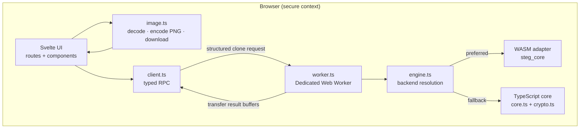

# Architecture

This document explains how masc is put together at runtime. It complements
[`STEGO_FORMAT.md`](./STEGO_FORMAT.md), which defines the byte layout of containers.

## Goals

1. **Local by default.** Files, messages, and passwords never leave the browser.
2. **Two correct implementations.** A canonical Rust core compiled to WASM, plus a
   dependency-free TypeScript mirror that works everywhere.
3. **Byte-for-byte compatibility.** Both engines must produce and consume identical
   containers.
4. **No UI freezes.** Pixel-heavy work runs in a dedicated Web Worker.
5. **Honest failure.** Corrupt, truncated, or wrong-password input produces a typed error
   instead of best-effort garbage.

## Non-goals

- Defeating steganalysis.
- Protecting data on a compromised device or browser.
- Recovering a payload after lossy re-encoding.
- Server-side storage, sync, accounts, or sharing links.
- Guaranteeing that a payload survives third-party image pipelines.

## Runtime topology



The Vite/SvelteKit server renders the shell, but there is no server-side steganography
endpoint. All payload handling occurs in the browser after hydration.

## Layers

| Layer | Files | Responsibility |
| --- | --- | --- |
| Presentation | `src/routes/`, `src/lib/components/` | Routing, workbench state, drag-and-drop, downloads |
| Image I/O | `src/lib/steg/image.ts` | Decode to RGBA, re-encode PNG, trigger downloads |
| Transport | `src/lib/steg/client.ts`, `worker.ts` | Typed request/response RPC over `postMessage` |
| Dispatch | `src/lib/steg/engine.ts` | Prefer WASM, fall back to TypeScript, expose one `StegEngine` |
| Canonical core | `crates/steg-core/` | Format parsing, LSB embedding, trailers, carving, crypto |
| Mirror core | `src/lib/steg/core.ts`, `crypto.ts` | Byte-compatible JavaScript implementation |
| Contract | `docs/STEGO_FORMAT.md` | Normative wire format shared by both cores |

## Request lifecycle

### Hiding a message in an image

1. The UI validates the selected file and decodes it on the main thread with
   `createImageBitmap` and an `OffscreenCanvas` (or a detached `<canvas>`).
2. The decoded image is rejected if it exceeds 40 megapixels.
3. The resulting RGBA buffer is sent to the worker. Requests are **cloned**, not
   transferred, because the main thread still needs the pixels for the preview.
4. If a passphrase was supplied, the worker seals the payload into a `STGECRY1`
   envelope. Sealing uses PBKDF2-HMAC-SHA256 and AES-256-GCM in either Rust or WebCrypto.
5. The engine writes the `STEGLSB1` header, CRC-32, payload, and zero-fill into the
   carrier slots.
6. The modified RGBA buffer is transferred back. The main thread re-encodes it as PNG and
   offers the result as a download.

### Revealing a message

1. The image is decoded and sent to the worker exactly as above.
2. The engine scans carrier slots for `STEGLSB1`. If the magic is not at offset zero, it
   advances pixel-aligned and retries up to `DEFAULT_MAX_SCAN` carriers.
3. The header is validated (version, reserved bits, lengths) and the CRC-32 is checked.
4. If the encrypted flag is set, the UI asks for a passphrase and unseals the envelope.
5. The plaintext is returned to the UI for display, copy, or download.

### Hiding a file behind a file

1. The decoy and secret file are read as bytes on the main thread.
2. The worker optionally seals the secret, builds an `STEGAPP1` trailer, and places it:
   - inside a private `stEg` PNG chunk before `IEND` when the decoy is a PNG, or
   - after the natural EOF marker for other formats.
3. The container is returned and downloaded.
4. On reveal, the engine removes the chunk or trailer, restores the original decoy, and
   returns both the hidden file and the restored decoy. If no trailer exists, it runs
   signature carving over the trailing bytes.

## Backend selection

`resolveEngine()` is memoised per worker:

```text
try to import /wasm/steg_core.js
  ├── success + version() works → WASM engine
  └── missing or broken         → TypeScript engine
```

A missing WASM build is not an error. The TypeScript engine implements the same
`StegEngine` interface and must pass the same vectors. The active backend is reported to
the UI through `version()` for diagnostics.

`static/wasm/` is generated by `npm run build:wasm`; a fresh clone works without a Rust
toolchain.

## Worker protocol

Every request has an `id` and a `type`. The worker replies with either a result or a
stable error code:

```ts
type StegRequest =
  | { id: number; type: 'init' }
  | { id: number; type: 'lsbCapacity'; ... }
  | { id: number; type: 'lsbEmbed'; ... }
  | { id: number; type: 'lsbExtract'; ... }
  | { id: number; type: 'attach'; ... }
  | { id: number; type: 'detach'; ... }
  | { id: number; type: 'carve'; ... }
  | { id: number; type: 'seal'; ... }
  | { id: number; type: 'unseal'; ... }
  | { id: number; type: 'isEnvelope'; ... };
```

Shared error codes (`CAPACITY_EXCEEDED`, `NO_CONTAINER`, `MALFORMED`,
`CHECKSUM_MISMATCH`, `BAD_PASSPHRASE`, `TRUNCATED`, `CRYPTO`, `WASM_MISSING`) let the UI
branch without matching error strings.

Requests are cloned because the main thread retains its preview buffers. Responses
transfer their result buffers back, which is where the bulk of the data moves.

## Format and state invariants

- Container version is independent of application version.
- All integers are little-endian; bit streams are written MSB-first.
- LSB slots are enumerated in raster order, and only fully opaque pixels are carriers.
- Unused carrier slots are zero-filled so re-embedding is deterministic.
- `payload_len` is authoritative; magic and CRC-32 validate the start and integrity of the
  payload.
- Trailers must keep the decoy renderable and, for PNG, spec-valid.
- Extracted filenames are sanitised to remove path components.

Any change to these invariants is a format change. See the parity checklist in
[`CONTRIBUTING.md`](../CONTRIBUTING.md#the-parity-contract).

## Security boundaries

| Boundary | Trust assumption |
| --- | --- |
| Browser → app | The app is static; it has no secret backend keys. |
| Main thread → worker | Both are same-origin; the worker reduces UI blocking, not trust. |
| JS → WASM | Same process; the WASM module receives copies/views of pixel and payload data. |
| Passphrase → envelope | Passphrase never leaves the browser; salt and IV are generated per seal. |
| Container → decoder | Container bytes are untrusted; lengths, offsets, CRCs, and tags are validated. |
| User → output | The user is responsible for lawful use and for keeping the original file. |

What masc cannot protect against:

- A compromised browser, extension, operating system, or device.
- A weak passphrase.
- Statistical detection of LSB embedding.
- Re-compression or editing that destroys the carrier.
- Anyone who obtains both the container and the passphrase.

See [`SECURITY.md`](../SECURITY.md) for reporting and the full threat model.

## Failure modes

| Condition | Behaviour |
| --- | --- |
| Payload larger than carrier capacity | `CAPACITY_EXCEEDED`, no output written |
| No `STEGLSB1` magic after resync window | `NO_CONTAINER` |
| Bad version, reserved bits, or length | `MALFORMED` |
| CRC-32 mismatch | `CHECKSUM_MISMATCH` |
| Wrong passphrase or damaged envelope | `BAD_PASSPHRASE` / `CRYPTO` |
| Truncated header or trailer | `TRUNCATED` |
| WASM module missing | Silent fallback to TypeScript |
| Image over 40 megapixels | Rejected before decoding work |

## Testing strategy

| Layer | Test |
| --- | --- |
| Rust core | `cargo test` — unit, integration, goldens, corruption, resync, carving |
| TypeScript core | `npm run test:steg` — Node test runner, goldens mirroring Rust |
| Typecheck | `npm run check` |
| Manual | Round trips with and without passphrase, PNG and JPEG decoys, corrupted input, large image |

Golden vectors in `crates/steg-core/tests/format.rs` and `tests/steg/` are the contract
between the two implementations. If they disagree, the change is not ready.

## Extending masc

PolyForm Strict does not permit modification, so obtain written permission from
CoderSilicon before preparing any change. See [`CONTRIBUTING.md`](../CONTRIBUTING.md).

- **New carrier format:** add decoding support in `image.ts` and document the preservation
  requirements. Method A still requires a lossless output (PNG).
- **New trailer placement:** update `docs/STEGO_FORMAT.md`, both cores, and the carving
  tests.
- **New crypto parameters:** bump the container/envelope version, update both cores, and
  keep old containers decodable.
- **New UI feature:** keep DOM work on the main thread and bytes in the worker.

---

© 2026 CoderSilicon. All rights reserved.
